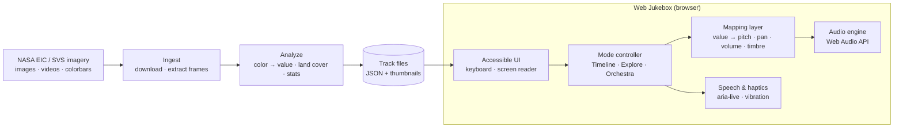

# Earth Information Jukebox — Architecture & Plan

**Author:** Chrysanthos
**Date:** 11 November 2026
**Status:** Early proposal from 11 November. The team went with a slightly different design; what was actually built is summarised right below and described in the [README](README.md).

---

## What we built compared to this plan (14 November)

| Plan | Status | What we did |
|---|---|---|
| Colour → real data value (colormap or colorbar) | ✅ Built | Named colormaps, an uploaded colorbar, or a colorbar detected automatically inside the frames. Brightness for maps without one (night lights). |
| "Change is the story" (Timeline mode) | ✅ Built, differently | Every frame plays as a west → east sweep; a rising or falling chime marks each change. Plus a mode the plan didn't have: **only what changed** (last frame minus first, in one sweep). |
| Pitch = value | 🔄 Changed | Pitch = latitude (north high, south low) and **loudness = value**, on a pentatonic scale. It tells you *where* things are, not only how much. |
| Stereo pan west → east | ✅ Built | |
| Written description + audio legend | ✅ Built | Spoken and written descriptions with numbers, percentages and place names; a spoken listening guide (L). |
| Keyboard and screen reader first | ✅ Built | Every control works from the keyboard (also with a Greek layout), `?` reads all shortcuts, `+`/`-` change the speed, `aria-live` announcements, visible focus, high contrast, phone layout. |
| Export to WAV | ✅ Built | The "Download sound" button. |
| GitHub Pages | ✅ Built | https://panagiotis676.github.io/nasa-app-hackathon/ |
| Python pipeline → JSON track files | 🔄 Changed | No JSON step: the browser decodes the images itself. Python builds the ready-made maps (`tools/`) and has its own command-line version (`image_describer.py`). |
| Tone.js | 🔄 Changed | Plain Web Audio API, nothing to load. |
| Explore mode (arrow-key cursor, vibration) | ✅ Built | `E` or "Explore the map": arrow keys, click or touch move a cursor that plays the spot under it; `Enter` says the place and value; phones vibrate. |
| Orchestra mode (land-cover instruments) | ❌ Not built | We focused on data maps instead of true-colour photos. |
| 2–3 EIC visualizations | ❌ One so far | NASA night lights 2012–2023. Any other map can be loaded under "Your maps". |

---

## 1. Summary

We build a **web-based Earth Jukebox**: a person picks a NASA Earth visualization and *hears* it. The focus is on **change over time** and on **blind and low-vision users**.

- A small **Python pipeline** (offline, run by us) turns NASA imagery into compact **data tracks** (JSON).
- A **static web app** (HTML + JavaScript, no server) loads a track and turns it into sound **in real time** in the browser, with full keyboard, screen-reader and haptic support.

Why this split: Python is what the team already uses for image processing. The browser is the best place for real-time, accessible audio, and a static site is easy to demo (open a link, works on laptop and phone).

## 2. Goals and non-goals

**Goals**

1. Let someone who cannot see the screen understand *how a part of the Earth changes* (e.g. warming, ice loss, deforestation).
2. Sound must carry **meaning** (a real data value), not just "how red a pixel is".
3. Sound must be **pleasant** — musical scales and limited voices, not noise.
4. Fully usable **without a mouse and without sight**.

**Non-goals (for the hackathon)**

- User accounts, databases, or a custom backend.
- Processing arbitrary uploads in real time (stretch goal only).
- Perfect scientific precision — we aim for honest, explainable mappings.

## 3. Design principles

| Principle | What it means in practice |
|---|---|
| **Meaning over pixels** | Convert color back into the data value it represents before making sound. |
| **Change is the story** | Every track has a time dimension or a before/after comparison. |
| **Accessibility first** | Keyboard and screen reader are designed first, mouse and visuals second. |
| **Musical by default** | Pentatonic or major scales, max 3–4 simultaneous voices, smooth envelopes. |
| **Explainable** | Each track has an audio legend ("this is what cold sounds like") and a written description. |

## 4. High-level overview



**Offline (Python, run by us):** Ingest → Analyze → Track files.
**Online (browser, run by the user):** Track files → UI → sound, speech and vibration.

## 5. Components

### 5.1 Ingest (Python)

- Downloads NASA visualizations (still images, image sequences or videos).
- Extracts frames from videos (OpenCV — reuses logic from `earth_video_with_sound.py`).
- Crops away titles, logos and the colorbar; saves the colorbar separately.

### 5.2 Analyze (Python)

Three analyzers, chosen per visualization:

| Analyzer | Input | Output | Used by |
|---|---|---|---|
| **Color → value** | Data visualization + its colorbar | A grid of real values (e.g. °C anomaly) per frame | Timeline, Explore |
| **Land cover** | True-color satellite photo | Share of water / vegetation / sand / ice-cloud per frame | Orchestra |
| **Summary stats** | Output of the above | Mean, min, max per frame (area-weighted for global maps) | Timeline |

**Color → value (key idea).** Most EIC visualizations encode a number with a color scale. We sample the colorbar into pairs `(color, value)`. For every pixel we find the nearest colorbar color (in Lab color space, which matches human perception better than RGB) and take its value. Pixels far from any colorbar color (coastlines, labels, masks) become `null` — "no data". This turns the team's original "0–100 score" idea into a score that means something.

**Land cover.** Simple, explainable color rules (HSV thresholds) classify pixels as water, vegetation, sand/soil, ice/cloud or other. Works on any true-color image — our fallback if the official data has no colorbar.

**Downsampling.** Grids are reduced to about 72 × 36 cells (5° per cell for global maps). That is plenty to hear and keeps files small.

### 5.3 Track files (the contract between Python and the web)

One JSON file per visualization in `web/data/`. Both sides only need to agree on this format.

```json
{
  "id": "global-temp-anomaly",
  "title": "Global surface temperature anomaly",
  "description": "Each map shows how much warmer or colder each region was compared to the 1951–1980 average.",
  "source": { "name": "NASA Scientific Visualization Studio", "url": "https://svs.gsfc.nasa.gov/" },
  "unit": "°C",
  "range": { "min": -2.0, "max": 2.0 },
  "modes": ["timeline", "explore"],
  "grid": { "width": 72, "height": 36, "projection": "equirectangular" },
  "legend": [
    { "value": -2.0, "text": "much colder than average" },
    { "value": 0.0, "text": "average" },
    { "value": 2.0, "text": "much warmer than average" }
  ],
  "frames": [
    {
      "label": "1980",
      "image": "frames/global-temp-anomaly/1980.webp",
      "mean": -0.05,
      "values": [0.1, 0.3, null, "... width × height numbers, row by row from the north-west corner"]
    }
  ]
}
```

For land-cover tracks, each frame carries `"classes": { "water": 0.42, "vegetation": 0.31, "sand": 0.20, "ice_cloud": 0.07 }` instead of `values`.

### 5.4 Mapping layer (browser)

Pure functions, no audio code — easy to test and tweak.

| Data | Sound parameter | Rule |
|---|---|---|
| Value (normalized 0–1) | **Pitch** | Snap to a pentatonic scale over 2–3 octaves (MIDI 48–84) |
| Above / below average | **Timbre** | Warm/bright sound above average, soft/dark below |
| Horizontal position (west → east) | **Stereo pan** | Left ear → right ear |
| Change since previous frame | **Tension** | Bigger change → brighter filter, slight detune |
| Land-cover share | **Volume** of that class's instrument | 0 % = silent, 100 % = full |
| No data (`null`) | **Silence or soft click** | Never a random note |

### 5.5 Audio engine (browser)

- Built on the native Web Audio API, with one mono master mix feeding equal-power left and right gains into a stereo merger.
- Max 3–4 voices at once, a master limiter, short attack/release envelopes — no clicks, no clipping.
- **Instruments for Orchestra mode:** water = soft pad, vegetation = marimba, sand/soil = low drone, ice/cloud = bells.
- Audio starts only after a key press or click (browsers block autoplay); the start button is the first focusable element.
- Optional **export to WAV** (OfflineAudioContext) so we can also submit a playlist, which the challenge allows.

### 5.6 Modes

**Timeline — "hear the change".**
Plays one note per frame (e.g. per year). The pitch follows the frame's mean value, so warming sounds like a rising melody. Every decade the year is announced. Controls: play/pause, speed, step frame by frame.

**Explore — "touch the map with your ears".**
The user moves a cursor cell by cell with arrow keys, touch or mouse. Each move plays the value under the cursor, panned left/right by position. Pressing Enter announces the value in words ("Arctic, 2012: 3.1 °C warmer than average"). On Android, the phone vibrates more strongly for higher values (iOS Safari does not support vibration).

**Orchestra — "hear the landscape".**
For true-color photos. Each land-cover class is an instrument; its loudness follows its share of the image. In a before/after pair, you hear for example the vegetation instrument fade as a forest disappears.

### 5.7 Accessible UI

- Plain semantic HTML: real `<button>`s, `<select>`, labels, headings.
- An `aria-live="polite"` region for announcements (year, value, mode changes).
- Visible focus outlines, high contrast, large text; works at phone width.
- Every track has a written description and a playable audio legend.
- Tested with VoiceOver (macOS/iOS), NVDA (Windows) and TalkBack (Android).

**Proposed keyboard map**

| Key | Action |
|---|---|
| `Space` | Play / pause |
| `←` `→` | Previous / next frame (Timeline) or move west / east (Explore) |
| `↑` `↓` | Move north / south (Explore) |
| `Enter` | Announce current value in words |
| `L` | Play the audio legend |
| `1` `2` `3` | Switch to Timeline / Explore / Orchestra |
| `+` `-` | Faster / slower |
| `?` | Announce all shortcuts |

## 6. Proposed folder structure

```
nasa-app-hackathon/
├── README.md
├── ARCHITECTURE.md
├── pipeline/                 # Python — offline data processing
│   ├── requirements.txt
│   ├── ingest.py             # download, extract frames, crop colorbar
│   ├── colormap.py           # color → value
│   ├── landcover.py          # pixel classification
│   └── build_tracks.py       # writes web/data/*.json
├── web/                      # Static site — the Jukebox
│   ├── index.html
│   ├── css/style.css
│   ├── js/
│   │   ├── app.js            # state, keyboard, wiring
│   │   ├── mappings.js       # data → sound parameters
│   │   ├── engine.js         # Audio voices and effects
│   │   ├── modes/            # timeline.js · explore.js · orchestra.js
│   │   └── a11y.js           # announcements, haptics
│   └── data/                 # generated track JSON + thumbnails
└── prototype/                # current scripts, kept for reference
```

The web app is fully static, so it can be hosted for free on **GitHub Pages** for the demo.

## 7. What we keep from the current prototype

| Current file | What we reuse | What changes |
|---|---|---|
| `image-to-score.py` | Loading images and per-pixel scoring with Pillow | Vectorize with NumPy; score = data value instead of R/G/B |
| `earth_video_with_sound.py` | Downloading NASA video, frame extraction with OpenCV, chord idea (melody + fifth + bass) | Fix the note clamp bug; move sound generation to the browser |
| `score-to-sound.py` | Idea of separate voices per channel | Becomes the per-class instruments in Orchestra mode |

## 8. Tech stack

| Part | Choice | Why |
|---|---|---|
| Data pipeline | Python 3.13, Pillow, NumPy, OpenCV, SciPy | Team already uses them |
| Front end | Plain HTML, CSS, JavaScript (no build step) | Fast to build, nothing to install |
| Audio | Web Audio API | Real-time synthesis and stereo routing in every modern browser |
| Speech | Screen reader via `aria-live`; Web Speech API as fallback | Works with the user's own screen reader |
| Hosting | GitHub Pages | Free, one link for judges |

## 9. Work split (suggested)

| Workstream | Main tasks |
|---|---|
| **Data & pipeline** | Ingest, color → value, land cover, build track files |
| **Sound design** | Scales, instruments, mappings, audio legend — make it sound good |
| **Web & accessibility** | UI, keyboard map, screen-reader testing, haptics |
| **Story & submission** | Pick the visualizations, write descriptions, demo video, project page |

## 10. Milestones

1. **Before Fri 13 Nov:** agree on this plan; set up folders; one end-to-end track using a public NASA visualization (e.g. global temperature anomaly).
2. **After resources are released (Fri 13 Nov):** choose 2–3 official EIC visualizations and generate their tracks.
3. **Build:** Timeline mode end-to-end → Explore mode → Orchestra mode.
4. **Polish:** eyes-closed testing by every team member, screen-reader pass, audio legend, descriptions.
5. **Submit:** deploy to GitHub Pages, record the demo video, explain our mapping choices.

## 11. Risks

| Risk | Mitigation |
|---|---|
| Official EIC data has no usable colorbar | Fall back to land-cover (Orchestra) mode, which works on any photo |
| Sound becomes noisy or tiring | Pentatonic scale, few voices, limiter, user-controlled speed |
| Browser blocks audio | Start audio only after the first key press / click |
| Large files slow on phones | Downsample grids, WebP thumbnails |
| Time runs out | Timeline mode alone is a complete, demoable product |

## 12. Open questions for the team

1. Is everyone OK with a web front end (JavaScript) plus a Python pipeline?
2. Which 2–3 visualizations tell the strongest "changing Earth" story?
3. Who takes which workstream?
4. Do we know a blind or low-vision person who could test it?
5. Git workflow: work directly on `main`, or use branches and pull requests?
